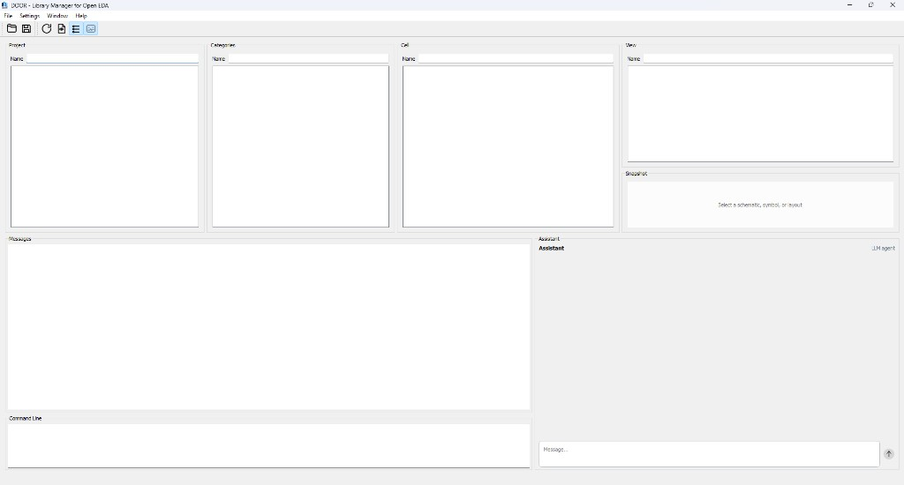

<p align="center">
  
</p>

### DOOR

**DOOR** (*Design Open Object Repository*) — Library Manager for Open EDA.

Formerly **LibMan**; repository: [`IHP-GmbH/Door`](https://github.com/IHP-GmbH/Door).

Uses **[ROOM](https://github.com/IHP-GmbH/Room)** ([Reusable Open Object Model](https://ihp-gmbh.github.io/Room/)) for `.room` cell views, import/export converters, and optional layout/schematic bridges. Without Room access DOOR still builds with stubs (`LIBMAN_NO_ROOM`); see [ROOM integration](docs/setup/ROOM_INTEGRATION.md).

---

## 📚 **Development Documentation**

**All setup and development documentation is organized in the [`docs/` folder](docs/INDEX.md).**

| Quick Links |  |
|--|--|
| **Getting Started** | [Quick Start (5 min)](docs/getting-started/QUICK_START.md) |
| **All Documentation** | [Documentation Index](docs/INDEX.md) |
| **Setup Help** | [VS Code Setup](docs/setup/VSCODE_SETUP.md) |
| **Project / libraries** | [Project Editor](docs/setup/PROJECT_EDITOR.md) · [Import](docs/setup/IMPORT.md) |
| **Layout / ROOM** | [KLayout](docs/setup/KLAYOUT_INTEGRATION.md) · [ROOM](docs/setup/ROOM_INTEGRATION.md) · [API docs](https://ihp-gmbh.github.io/Room/) |
| **Schematic (WSL)** | [Xschem integration](docs/setup/XSCHEM_INTEGRATION.md) |
| **Command Line** | [Python console (CML)](docs/setup/PYTHON_CONSOLE.md) |
| **Troubleshooting** | [Common Issues](docs/reference/TROUBLESHOOTING.md) |
| **Quick Reference** | [Shortcuts & Commands](docs/reference/QUICK_REFERENCE.md) |

---

### Goals of the project
- Develop a Library Manager to unite Open Source EDA tools into a flow.
- Provide similar Library Manager functionality to the ones provided by to commercial companies.
- Design User Interface in a way the users got used to.
- Make it easily customizable and extendable based on user requests/preferences.

### Top Features
DOOR helps to organize libraries and cell views in a design project:
- Create new libraries in your directories.
- Copy data into libraries.
- Delete libraries.
- Rename libraries, cells, views.
- Edit libraries, cells, and views.
- Organize cells into categories.
- Unite libraries into groups.
- Display libraries, cells, views information.
- Navigate through libraries, cells, views.

### Project file support

- Project file is used to specify and store the location of the reference and design libraries
- DOOR displays the libraries, categories, cells, and views specified in project file
- Project file can be loaded by
-- Explicitly specifying it as command line argument
-- Running DOOR from a folder where project file is saved
-- Loading from the recent file menu

Example of project file:

  GROUP Text test1 test2  
  PROJECT test1 ~/test1
  PROJECT test2 ~/test2   
  
 Where 
 - GROUP is used to unite libraries (if desiered).
 - PROJECT specifies name of the library and its location.

### Building requirements
- GCC 8+ / MinGW-w64 (CI uses MinGW 8.1, 64-bit)
- Qt 5.15.x
- CMake 3.16+ (VS Code / local) or qmake (CI, Qt Creator)
- ZLIB (see [Dependencies](docs/getting-started/DEPENDENCIES.md))
- Git, and on Linux CI: autoconf, automake, libtool

Cap'n Proto and LStream schemas are **not** in the repository; they are cloned and built on first compile. See **[Build guide](docs/BUILD.md)** for full steps (qmake vs CMake, Windows patch script, CI).

### Building project (qmake)
```bash
mkdir -p build && cd build
qmake ../door.pro
make -j1 capnp_install
make -j1 lstream_schemas
make -j$(nproc)
```

On Windows with MinGW, run `scripts\mkcapnp.cmd` from the repo root first, then `bash ../scripts/patch_capnp_makefile.sh` after `qmake` — see [docs/BUILD.md](docs/BUILD.md).

### Building project with QtCreator

1. Open QtCreator and go to "Tools > Options > Kits"
2. Go to "Qt Versions" add press "Add" - select the qmake executable generated by the configure script. Then hit "Apply".
3. Go to "Kits" and press "Add" - Make shure to select the correct compilers and debugger and select the previously create "Qt Version". Press "Ok".
4. Open the top level door.pro file in QtCreator and choose the previously created Kit. QtCreator will now use the correct qmake executable.
5. Run building button to compile the project.

### Roadmap

- Provide arguments support to exectute view editors (Q4 2023)
- Git support for design data in DOOR (2024)

### Main Interface

DOOR’s main window is built around a familiar library-manager layout, with ROOM-backed cell views and tool bridges in one place:

- **Project → Categories → Cell → View** — navigate libraries and cell views the way users expect from commercial flows; filter by category and open schematic, symbol, or layout views.
- **Snapshot** — preview the selected schematic, symbol, or layout without leaving the manager.
- **Messages & Command Line** — follow status output and drive common actions from a Python-capable command line (see [Python console](docs/setup/PYTHON_CONSOLE.md)).
- **Assistant (LLM agent)** — optional side panel for interactive help while browsing design data.
- **Tool integration** — open views with KLayout (layout / ROOM), Xschem / Qucs-S (schematic), and keep design data in ROOM `.room` files ([ROOM](https://github.com/IHP-GmbH/Room), [KLayout](docs/setup/KLAYOUT_INTEGRATION.md), [Xschem](docs/setup/XSCHEM_INTEGRATION.md)).

<p align="center">
  
</p>

### Doxygen cooment style support and documentation generation

Doxygen was used to parse the source code and generate documentation.


### Links

[Qt download](https://download.qt.io/archive/qt/ "Qt download")

[QtCreator](https://github.com/qt-creator/qt-creator "QtCreator download")

[Doxygen](https://www.doxygen.nl/download.html "Doxygen")

